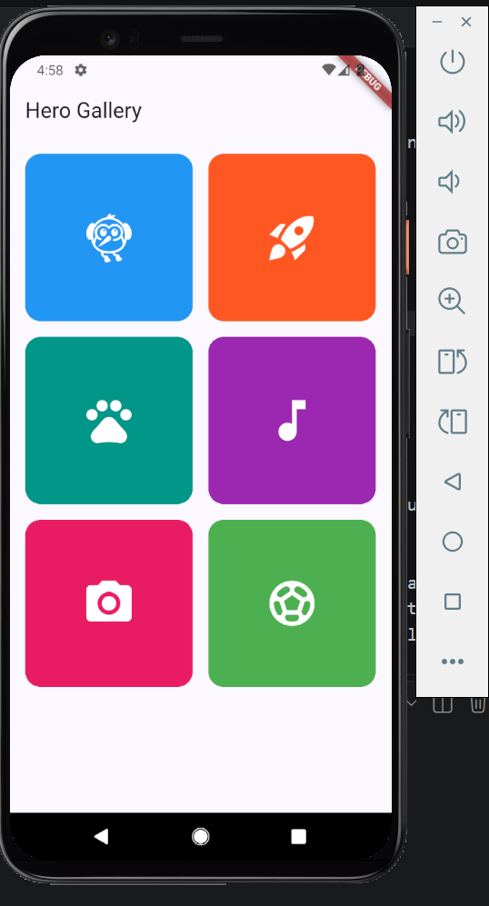

# Flutter Hero Widget Demo

A small Flutter app that shows how the **`Hero`** widget works. Tap a tile in the gallery and it flies into the detail page, then flies back when you go back.

> Widget presentation for **[Widget Presentation]** by **[KABANDA GISLAIN]**



*(Still screenshot in case the GIF doesn't load: `lib\screens\images\Homepage.png`)*

---

## What is `Hero`?

`Hero` marks a widget so Flutter can animate it from one screen to another during a route transition. Give the widget on screen A and the widget on screen B the **same tag**, and Flutter handles the animation between them.

**Real-world use case:** an online store. You tap a product thumbnail in a grid, and the image grows into the header of the product page. It makes the app feel connected instead of like two separate screens. My demo is a mini version of that: a grid of tiles that open into a detail view.

---

## How to run it

You need [Flutter](https://docs.flutter.dev/get-started/install) installed.

```bash
git clone (https://github.com/cashme8/hero_widget)
cd [/hero_widget]
flutter pub get
flutter run
```

Works on an emulator, a physical device, or Chrome (`flutter run -d chrome`).

---

## How the code works

Everything is in `lib/main.dart`.

1. **`GalleryPage`** shows a 2-column `GridView` of colored tiles.
2. Each tile is wrapped in a `Hero` with the tag `'item-${item.id}'`.
3. Tapping a tile calls `Navigator.push` to open **`DetailPage`**.
4. `DetailPage` wraps its header in another `Hero` with the **same tag**.
5. Flutter sees the matching tags and animates the widget from the tile's position and size to the header's.

```dart
// Gallery page
Hero(
  tag: 'item-${item.id}',   // must be unique on this page
  child: Container(...),
)

// Detail page
Hero(
  tag: 'item-${item.id}',   // same tag = Flutter links the two
  child: Container(...),
)
```

> Two Heroes with the same tag on the **same** page will throw an error. That's why I use the item's ID in the tag.

---

## Attributes I demonstrated

I picked three `Hero` properties, changed each one live in the presentation, and looked at what happened.

| Attribute | Default value | What I changed it to | Visual effect | Why a developer would change it |
|---|---|---|---|---|
| `createRectTween` | `MaterialRectArcTween` (the Hero flies along a curved arc) | `RectTween` (straight line) | The tile now flies in a straight line instead of curving | When the design calls for a more direct, snappy motion, or the arc looks odd on long distances |
| `placeholderBuilder` | `null` (a blank empty space is left where the tile was) | A grey box the same size as the tile | A grey placeholder stays in the grid while the tile is in flight | So the layout doesn't look like it has a hole in it during the transition |
| `flightShuttleBuilder` | `null` (Flutter shows the destination Hero's child) | My own builder that shrinks the corner radius and grows the icon | Corners and icon size change smoothly instead of snapping at the end | When the two screens look different (rounded vs. square, small vs. large) and you want control over how it looks mid-flight |

### Code for each change

**1. `createRectTween`**
```dart
Hero(
  tag: 'item-${item.id}',
  createRectTween: (begin, end) => RectTween(begin: begin, end: end),
  child: ...,
)
```

**2. `placeholderBuilder`**
```dart
Hero(
  tag: 'item-${item.id}',
  placeholderBuilder: (context, heroSize, child) => Container(
    width: heroSize.width,
    height: heroSize.height,
    color: Colors.grey.shade300,
  ),
  child: ...,
)
```

**3. `flightShuttleBuilder`**
```dart
Hero(
  tag: 'item-${item.id}',
  flightShuttleBuilder: (context, animation, direction, fromCtx, toCtx) {
    return AnimatedBuilder(
      animation: animation,
      builder: (context, _) => Container(
        decoration: BoxDecoration(
          color: item.color,
          borderRadius: BorderRadius.circular(16 * (1 - animation.value)),
        ),
        child: Icon(
          item.icon,
          size: 56 + 84 * animation.value,
          color: Colors.white,
        ),
      ),
    );
  },
  child: ...,
)
```

> **Tip for testing:** set `timeDilation = 5.0;` (from `package:flutter/scheduler.dart`) in `main()` to slow animations down so you can see exactly what each property does.

---

## Things I learned

- Hero only animates the **bounds** (size and position) by default. It doesn't animate what's inside, so things like corner radius and icon size snap unless you use a flight shuttle.
- If a Hero contains text, wrap it in a `Material` widget. Otherwise you get yellow double underlines mid-flight.
- If the tags don't match, nothing breaks. You just get a normal page transition with no flight.
- Swipe-back on iOS only animates the Hero if `transitionOnUserGestures: true` is set.

---

## Project structure

```
.
├── lib/
│   └── main.dart        
├── screenshots/
│   ├── demo.gif         # animation in action
│   └── Homepage.png         # still screenshot
├── pubspec.yaml
└── README.md
```

---

## Built with

- Flutter (Material 3)
- Dart

---

## Author

**Mobile Development Course**
HERO WIDGET / CODE · third semester / 2026
GitHub: [@cashme8](https://github.com/cashme8)